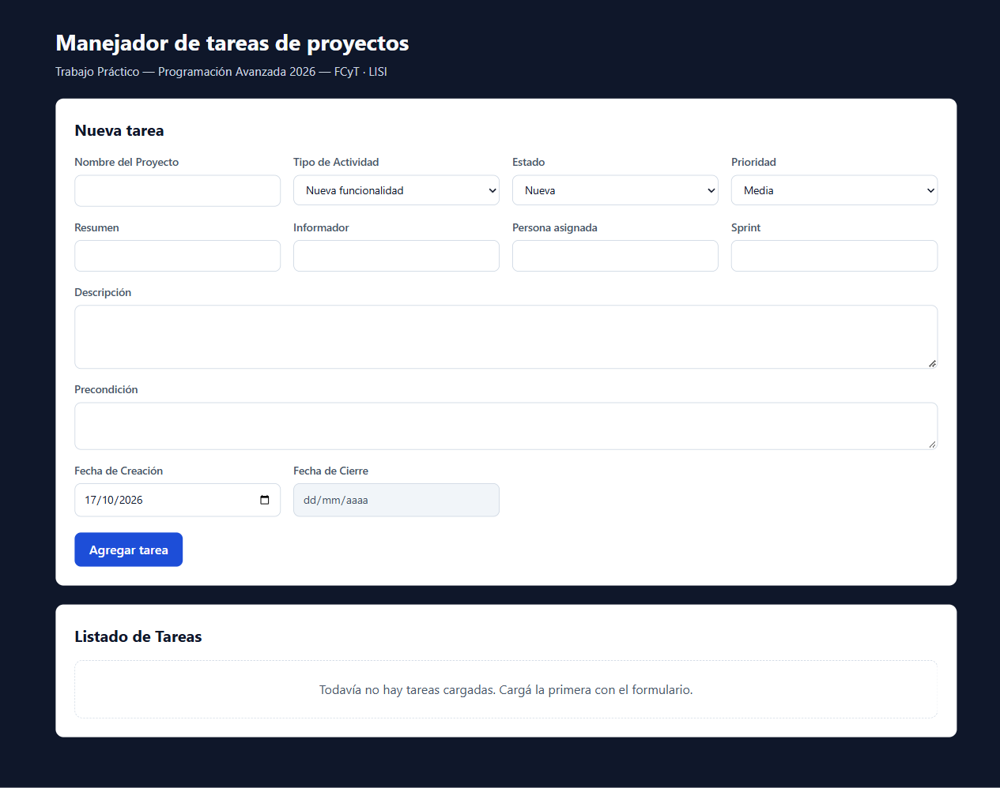
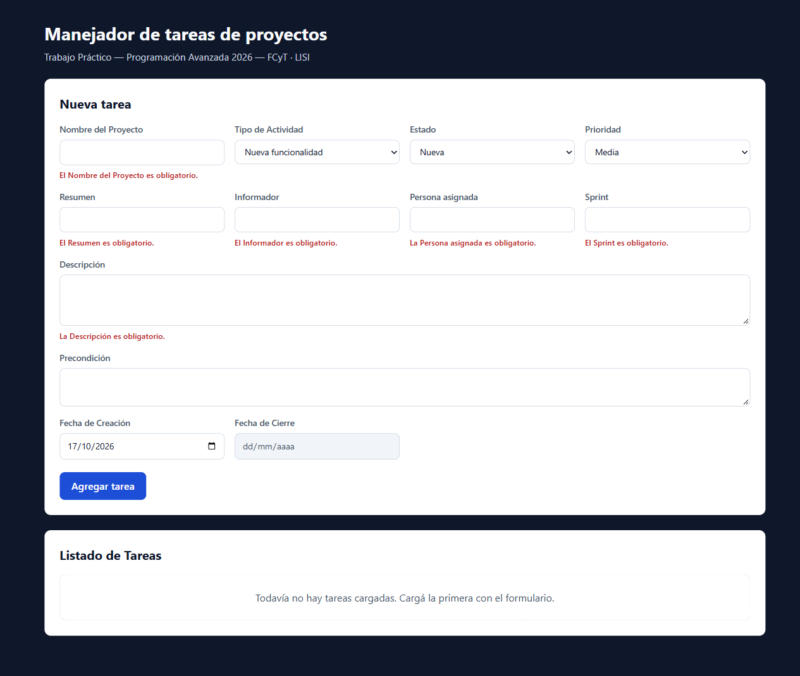
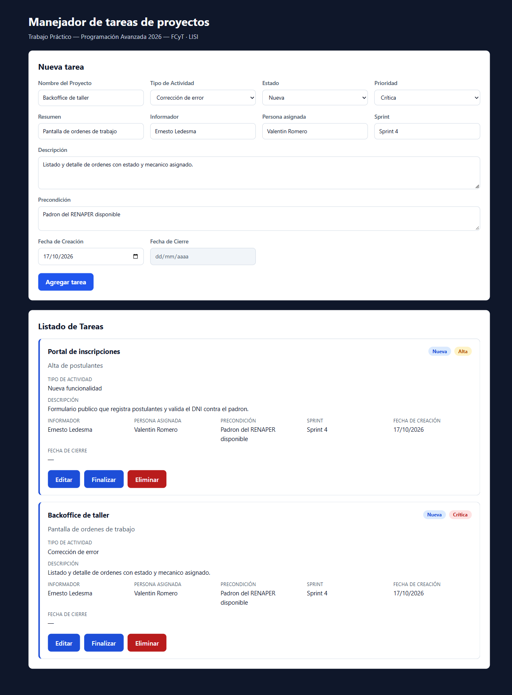
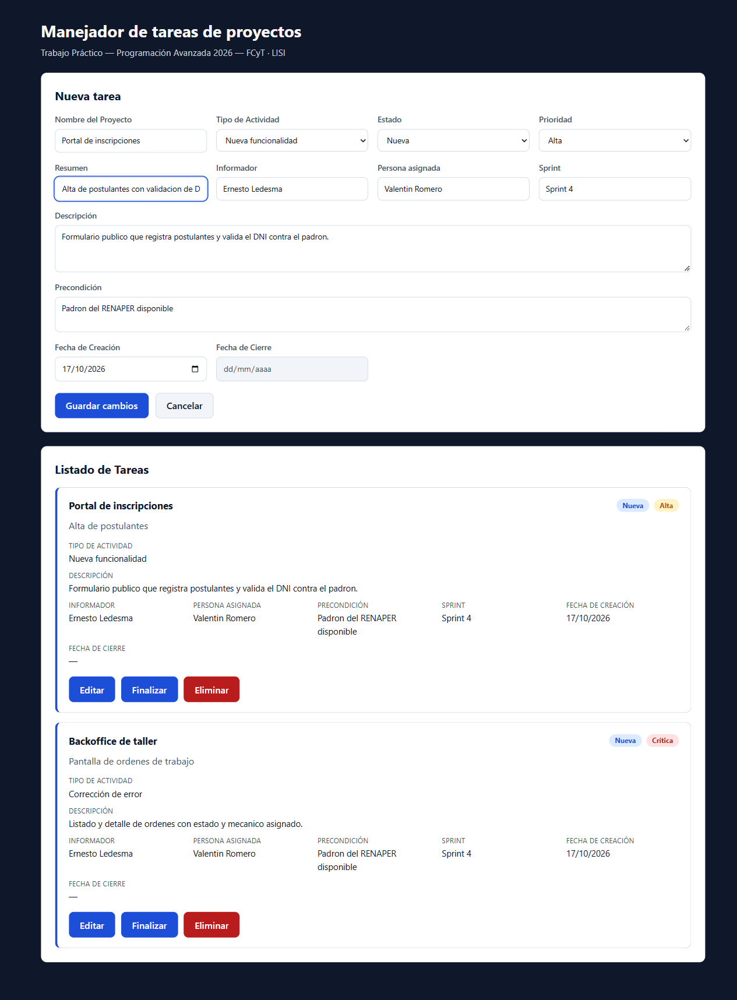
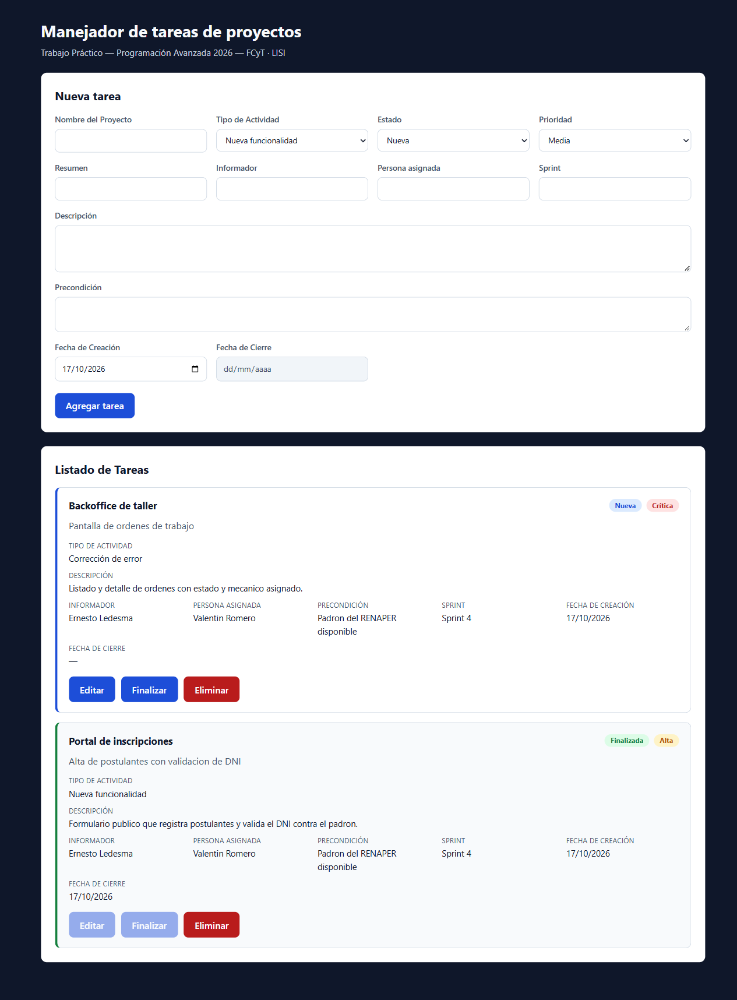
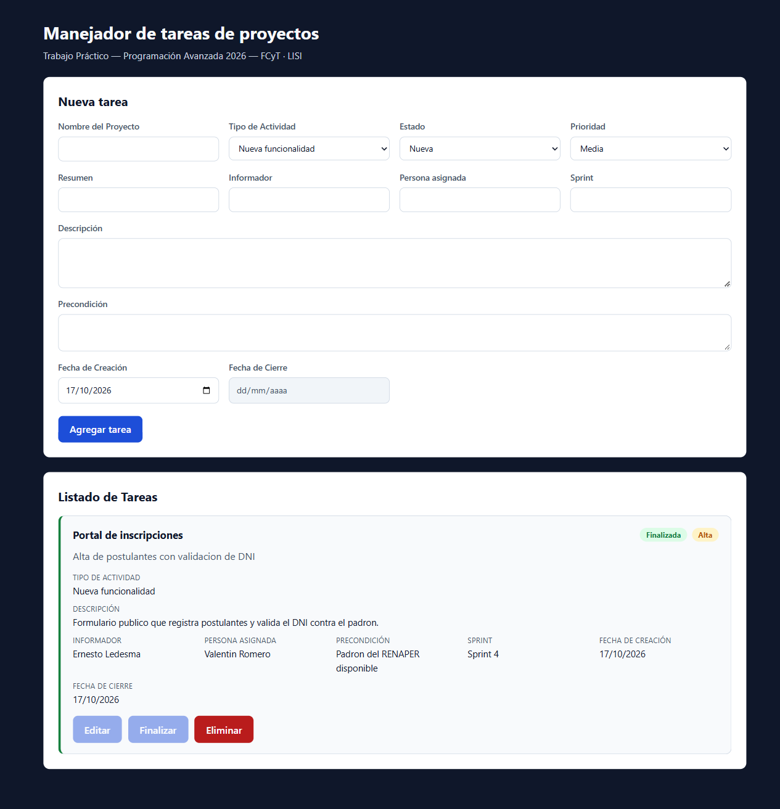

# Evidencias — TP5 · Manejador de tareas de proyectos

Capturas sacadas con un navegador real (Chromium) contra la aplicación levantada
con `docker compose up --build`, en `http://localhost:8080`. La base arrancó
vacía, así que lo que se ve es el flujo completo desde cero.

**Fecha:** 17 de octubre de 2026

---

## 01 — Formulario con los 12 campos



Los doce campos que pide la consigna: **Nombre del Proyecto, Tipo de Actividad,
Estado, Resumen, Descripción, Prioridad, Informador, Persona asignada,
Precondición, Fecha de Creación, Fecha de Cierre y Sprint**.

*Fecha de Cierre* aparece como campo de sólo lectura: la asigna la operación
**Finalizar**, no se escribe a mano.

---

## 02 — Validación de los campos obligatorios



Al intentar guardar con el formulario vacío, la app **no llama a la API**: marca
los 6 campos obligatorios que faltan, cada mensaje abajo de su input. El backend
valida lo mismo por su lado y responde `400 VALIDACION` con el detalle por campo.

---

## 03 — Alta y componente "Listado de Tareas"



Dos tareas creadas desde el formulario. El componente **"Listado de Tareas"**
muestra el proyecto, el resumen, los badges de estado y prioridad, y el detalle
completo de los doce campos de cada tarea.

---

## 04 — Edición



"Editar" carga la tarea en el mismo formulario, en modo edición ("Guardar
cambios" / "Cancelar"). Se modificó el resumen y el cambio quedó persistido en
Postgres.

---

## 05 — Finalizar



"Finalizar" pasa la tarea a **Finalizada**, sella la **Fecha de cierre** y deja
*Editar* y *Finalizar* deshabilitados. Del lado del backend, la operación es
`PATCH /api/tasks/:id/finalizar`, y cualquier intento de editar una tarea
cerrada se rechaza con `409 TAREA_FINALIZADA_NO_EDITABLE`.

---

## 06 — Eliminar



"Eliminar" borra la tarea de la base (`DELETE /api/tasks/:id` → `204`). Queda
sólo la tarea finalizada, con su fecha de cierre.

---

## Cómo reproducirlo

```bash
docker compose up --build
# abrir http://localhost:8080
```

Los tests automáticos cubren la misma lógica sin necesidad de navegador:

```bash
cd backend  && npm test     # 31 tests (dominio + rutas)
cd frontend && npm test     # 13 tests (formulario + listado)
```
